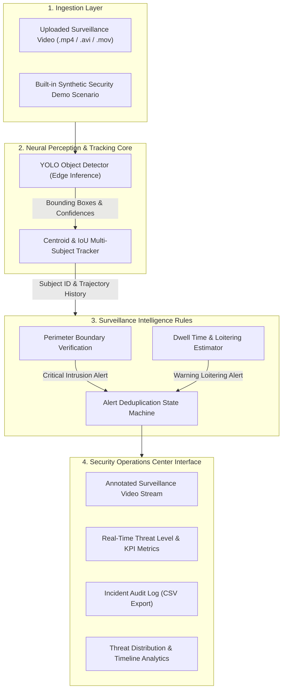

# VisionGuard AI

> **Intelligent Video Surveillance & Real-Time Threat Detection System**

VisionGuard AI is an advanced, standalone intelligent video surveillance system designed to provide real-time automated physical security monitoring. Built with an edge-first computer vision architecture, it continuously analyzes surveillance video feeds, detects targets, tracks identities, identifies perimeter breaches, detects unauthorized loitering, and generates actionable security intelligence without relying on cloud APIs.

---

## 📌 Problem Statement

Conventional CCTV video surveillance infrastructure suffers from significant operational limitations:
- **Operator Fatigue**: Security operators monitoring dozens of screens simultaneously miss critical micro-events.
- **Delayed Response**: Reviewing footage post-incident fails to prevent perimeter violations in real time.
- **Privacy & Bandwidth Constraints**: Streaming uncompressed high-resolution feeds to cloud inference endpoints introduces high latency, recurring subscription costs, and sensitive data leakage risks.

## 💡 The VisionGuard Solution

VisionGuard AI solves these challenges by deploying an intelligent on-premise edge analysis pipeline:
- **Instant Threat Detection**: Automated rules engine flags restricted-zone intrusions and abnormal loitering in real time.
- **Zero Cloud Transmission**: All inference, tracking, and rendering execute locally on hardware, ensuring strict data sovereignty and privacy.
- **SOC-Ready Dashboard**: An intuitive Security Operations Center interface provides interactive analytics, incident logs, and annotated video review.

---

## 🚀 Key Features

- **Multi-Class AI Detection**: High-accuracy detection of pedestrians, vehicles (cars, buses, trucks, motorcycles, bicycles), and unattended baggage using YOLO neural networks.
- **Persistent Multi-Subject Tracking**: Centroid and Intersection-over-Union (IoU) tracker maintaining distinct identities across frames with trajectory visualization.
- **Restricted Perimeter Intrusion Monitoring**:
  - Dynamically configurable rectangular security perimeters.
  - Automatic detection when unauthorized subjects cross into restricted zones.
  - Generates immediate **Critical** alerts with frame timestamps.
  - Deduplication prevents repetitive alerts during a single continuous breach.
- **Loitering & Dwell Time Analytics**:
  - Continuous measurement of subject dwell duration within camera coverage.
  - Generates **Warning** alerts when configurable dwell thresholds (e.g., 5 seconds) are exceeded.
  - Zero duplicate alerting for ongoing loitering episodes.
- **SOC Visual Heads-Up Display (HUD)**:
  - Real-time video rendering with hazard boundaries, corner-accented bounding boxes, and identity tags.
  - Threat level indicator badge (**NORMAL**, **ELEVATED**, **CRITICAL**).
- **Incident Management & Reporting**:
  - Tabular event log detailing Event ID, Timestamp, Severity, Object Class, and Description.
  - One-click CSV incident export for audit compliance.
  - Downloadable annotated surveillance video for digital evidence archiving.
- **Interactive Threat Analytics**:
  - Visual charts powered by Plotly for target distribution, event severity breakdowns, and chronological incident scatter timelines.

---

## 🏗️ System Architecture



---

## 📂 Project Structure

```text
VisionGuard-AI/
│
├── app.py              # Streamlit SOC dashboard application
├── detector.py         # YOLO inference engine & OpenCV HUD renderer
├── tracker.py          # Centroid & IoU identity tracking implementation
├── alerts.py           # Event classification, intrusion & loitering rules
├── config.py           # Operational settings, palettes & class constants
├── requirements.txt    # Project Python dependencies
├── .gitignore          # Git exclusion rules for large models & video media
├── LICENSE             # Open-source MIT License
├── assets/             # Visual resources and documentation placeholders
└── outputs/            # Generated annotated videos and CSV incident logs
```

---

## ⚡ Getting Started

### 1. Prerequisites
- Python 3.10, 3.11, 3.12, or 3.14
- Git installed on your system
- Modern web browser (Chrome, Edge, Firefox)

### 2. Clone the Repository
```bash
git clone https://github.com/Lahari-333/VisionGuard-AI.git
cd VisionGuard-AI
```

### 3. Install Dependencies
```bash
pip install -r requirements.txt
```

### 4. Run the Application
Launch the VisionGuard AI Streamlit interface:
```bash
streamlit run app.py
```
The application will open automatically in your browser at `http://localhost:8501`.

---

## 🌐 Cloud Deployment (Streamlit Community Cloud)

VisionGuard AI is fully optimized and configured for seamless deployment on **Streamlit Community Cloud**.

- **Deployment Platform**: Streamlit Community Cloud (Headless Linux Container)
- **GitHub Repository**: [https://github.com/Lahari-333/VisionGuard-AI](https://github.com/Lahari-333/VisionGuard-AI)
- **Direct 1-Click Launch**: [Deploy on Streamlit Community Cloud](https://share.streamlit.io/deploy?repository=Lahari-333/VisionGuard-AI&branch=main&mainModule=app.py)
- **Live Application URL**: [https://visionguard-ai.streamlit.app](https://visionguard-ai.streamlit.app)

### Deployment Configuration Steps
1. Navigate to [Streamlit Community Cloud](https://share.streamlit.io/).
2. Log in with your authorized GitHub account (`Lahari-333`).
3. Click **New app** and select:
   - **Repository**: `Lahari-333/VisionGuard-AI`
   - **Branch**: `main`
   - **Main file path**: `app.py`
   - **App URL**: `visionguard-ai` (or your preferred custom URL)
4. Click **Deploy!**. Streamlit Cloud will automatically install system media packages via `packages.txt` and Python requirements via `requirements.txt`.

### Cloud Hosting Architecture & Optimizations
- **CPU Inference Acceleration**: Cloud instances execute on shared CPU resources. The processing pipeline automatically normalizes video dimensions to 640px and caps long analysis runs (~300 frames) with dynamic striding to avoid container timeouts.
- **Strict Privacy & Ephemeral Cleanup**: Uploaded surveillance files are processed in secure memory/temporary storage and purged immediately in a `finally` block.
- **Disk Space Management**: Generated annotated surveillance video outputs automatically prune older files to maintain a lightweight storage footprint.
- **100MB File Upload Ceiling**: Set in `.streamlit/config.toml` to protect against container Out-Of-Memory (OOM) termination.

---

## 📖 Operational Workflow

1. **Select Footage Source**:
   - In the sidebar, choose between uploading an MP4 surveillance clip or clicking **Load Built-In Surveillance Demo** for an immediate hands-on test.
2. **Define Detection Parameters**:
   - Adjust the **AI Detection Confidence** slider (default: `0.38`).
   - Configure the **Loitering Threshold** (default: `5.0` seconds).
3. **Configure Restricted Perimeter**:
   - Adjust the normalized boundary sliders (X Min, Y Min, X Max, Y Max) to map the security zone on the surveillance floor.
4. **Execute Analysis**:
   - Click **🚀 Run Surveillance Analysis**.
   - Monitor real-time progress, frame decoding, and active threat status.
5. **Review & Export Evidence**:
   - View the annotated video stream with the HUD overlay.
   - Download the processed MP4 evidence video.
   - Navigate to the **Security Incident Log** tab to download audit CSV reports.
   - Explore temporal patterns on the **Threat Intelligence Analytics** tab.

---

## 🛡️ Rules & Alert Logic

| Alert Severity | Event Type | Trigger Criteria | Deduplication Policy |
| :--- | :--- | :--- | :--- |
| **CRITICAL** | Restricted-Zone Intrusion | Tracked person's center or contact point enters the defined restricted perimeter box. | Triggered once upon entry; resets only if the subject exits the perimeter. |
| **WARNING** | Loitering Detected | Tracked person remains continuously visible in camera frame longer than configured seconds. | Triggered once per continuous dwelling episode; prevents repeated alerts. |
| **NORMAL** | Standard Track | Object detected and tracked with no security rule violations. | Standard surveillance state. |

---

## ⚖️ Third-Party Dependencies & Licensing

VisionGuard AI integrates open-source components with respective attributions:
- **Ultralytics YOLO**: Used for object detection inference. Licensed under AGPL-3.0 (with commercial licensing available via Ultralytics Inc.).
- **OpenCV**: Open Source Computer Vision library licensed under Apache 2.0.
- **Streamlit**: Web application framework licensed under Apache 2.0.
- **Plotly**: Data visualization library licensed under MIT License.
- **Pandas & NumPy**: Data processing and numeric matrix libraries licensed under BSD 3-Clause.

---

## 🔮 Future Enhancements

- Support for live RTSP/ONVIF CCTV camera streaming.
- Directional tripwire detection (bi-directional perimeter line crossing).
- Night vision / low-light enhancement filter for infrared cameras.
- Webhook notifications for Slack, Discord, and Telegram incident alerts.

---

## 👤 Author & Maintainer

- **Developer**: [Lahari-333](https://github.com/Lahari-333)
- **Repository**: [VisionGuard-AI](https://github.com/Lahari-333/VisionGuard-AI)
- **License**: [MIT License](LICENSE)
